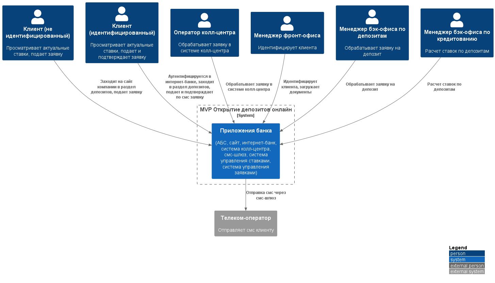
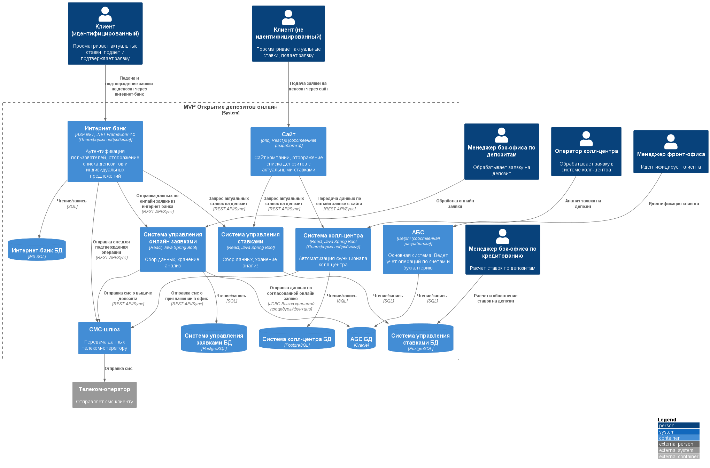

### **Название задачи:**  MVP открытия депозитов онлайн
### **Автор:** -
### **Дата:** 24.09.2026
### **Функциональные требования**

|**№**|**Действующие лица или системы**|**Use Case**|**Описание**|
| :-: | :- | :- | :- |
| UC1 | Клиент (без идентификации), сайт        | Просмотр списка депозитов    | 1. Клиент заходит на сайт компании, без авторизации                                           |
|     |                                         | на сайте компании            | 2. Клиент заходит в раздел по депозитам и видит список доступных с актуальными ставками       |
| UC2 | Клиент (без идентификации), сайт        | Подача заявки на депозит     | 1. Клиент выбирает депозит из списка                                                          |
|     |                                         |                              | 2. Клиент заполняет данные: номер телефона, ФИО                                               |
|     |                                         |                              | 3. Сайт передает чувствительные данные, используя шифрование, в систему колл-центра           |
|     |                                         |                              | 4. Пользователь ожидает звонка от оператора колл-центра банка                                 |
| UC3 | Оператор колл-центра,                   | Обработка заявки на депозит  | 1. Оператор видит в системе колл-центра новую заявку, изучает её и определ условия            |
|     | система колл-центра                     |                              | 2. Оператор обрабатывает заявку, определяет условия выдачи депозита                           |
|     |                                         |                              | 3. Оператор звонит клиенту и приглашает в офис для идентификации                              |
| UC4 | Клиент (без идентификации),             | Идентификация нового клиента | 1. Клиент пришел в офис с документами                                                         |
|     | менеджер фронт-офиса, АБС               | в отделении                  | 2. Менеджер фронт-офиса сканирует документы, загружает в АБС                                  |
| UC5 | Клиент (идентифицированный),            | Просмотр депозитов и         | 1. Клиент аутентифицируется в интернет-банке                                                  |
|     | интернет-банк                           | персональных ставок в        | 2. Клиент заходит в раздел по депозитам и видит список доступных с актуальными общими и       |
|     |                                         | интернет-банке               | персональными ставками                                                                        |
| UC6 | Клиент (идентифицированный),            | Подача заявки на депозит     | 1. Клиент выбирает депозит из списка                                                          |
|     | интернет-банк, АБС, смс-шлюз            |                              | 2. Клиент указывает счет и сумму депозита                                                     |
|     |                                         |                              | 3. Интернет-банк через смс-шлюз отправляет смс для подтверждения подачи заявки                |
|     |                                         |                              | 4. Клиент подтверждает операцию                                                               |
|     |                                         |                              | 5. Интернет-банк передает заявку в АБС/новый микросервис для обработки                        |
|     |                                         |                              | 6. Клиент ожидает согласования заявки                                                         |
| UC7 | Менеджер бэк-офиса по депозитам,        | Обработка заявки на депозит  | 1. Менеджер бэк-офиса видит новую заявку в АБС/новой системе по управлению ставками           |
|     | АБС, смс-шлюз                           |                              | 2. Менеджер бэк-офиса обрабатывает заявку, подтверждает условия депозита в АБС/новой системе  |
|     |                                         |                              | по управлению ставками                                                                        |
|     |                                         |                              | 3. АБС/новая система по управлению ставками через смс-шлюз отправляет смс о согласовании      |
|     |                                         |                              | ставки и открытии депозита                                                                    |
| UC8 | Специалист отдела кредитования,         | Управление ставками по       | 1. Специалист отдела кредитования рассчитывает ставки в Excel/новой системе по управлению     |
|     | Менеджер бэк-офиса по депозитам         | депозитам                    | ставками на основе ставки ЦБ и данных портфеля клиентов                                       |
|     |                                         |                              | 2. Специалист отдела кредитования передает данные по ставкам менеджерам бэк-офиса по депозитам|
|     |                                         |                              | или обновляет информацию по ставкам в системе по управлению ставками, к которой есть доступ   |
|     |                                         |                              | у других специалистов                                                                         |
### **Нефункциональные требования**
Опишите здесь нефункциональные требования и архитектурно значимые требования.

|**№**|**Требование**|
| :-: | :- |
| U1  | Интерфейс должен соответствовать интерфейсам интернет-банка и сайта, состоять из привычных     |
|     | цветов и брендированных элементов, быть максимально удобным, следовать дизайн-системе          |
| R1  | Все сервисы должны работать 24/7                                                               |
| R2  | При сбое ЦОД сервисы интернет-банка должны быть доступны, переключаться на резервный ЦОД и     |
|     | выдерживать целевую нагрузку                                                                   |
| P1  | Отклик по всем операциям должен быть максимально быстрым и занимать миллисекунды               |
| P2  | Предусмотреть равномерное горизонтальное масштабирование и распределение запросов между        |
|     | серверами, приложениями и ЦОД                                                                  |
| S1  | Максимально использовать существующие технологии и экспертизу банка                            |
| S2  | Подготовить документацию для дальнейшего расширения системы                                    |
| S3  | Новые технологии должны быть совместимы с существующими платформами разработки                 |
| +R1 | Данные, получаемые с сайта компании, необходимо защищать с помощью механизма шифрования трафика|
| +R2 | Данные, получаемые с интернет-банка, необходимо защищать с помощью механизма шифрования        |
| +R3 | Фронтенд - React.js / ASP.NET MVC 4.5. Бэкенд - php / .NET Framework 4.5 / python / java       |
| +R4 | Базы данных - MS SQL / Oracle / Postgresql                                                     |
| +R5 | Очередь сообщений - в приоритете kafka. Несовместима с текущей версией платформы интернет-банка|
| +R6 | База данных системы АБС уже перегружена                                                        |
| +R9 | АБС может масштабироваться только вертикально из-за своей БД                                   |
| +R10| Новых клиентов нельзя принимать без личной проверки документов в отделении                     |
| +R11| Функционал СМС реализован в ядре интернет-банка, но доработка подрядчика нежелательна, нужно   |
|     | реализовать силами команды банка                                                               |
| +R12| Ставки по депозитам сейчас ведутся только в XLS-файлах                                         |
| +R13| Интернет-банк сейчас работает в одном ЦОД на одной группе серверов. Есть резервный ЦОД         |

### **Решение**
#### Диаграмма контекста

#### Диаграмма контейнеров

#### Описание принятия решения
Предлагается добавить два новых микросервиса "Система управления ставками" и "Система управления онлайн-заявками", основываясь на:
1. Разделение доменов. АБС — это основная система, где производится учёт операций по счетам и бухгалтерия. Заявки и ставки — не её работа. Выносим их в отдельные сервисы, чтобы разгрузить перегруженную БД АБС.
2. Минимум изменений в функционирующих системах.
3. Использование существующих технологий. Java Spring Boot (есть в кол-центре и у команды АБС), PostgreSQL, REST, JDBC, React.js
4. Возможность горизонтального масштабирования. Новые сервисы масштабируются горизонтально, АБС же может масштабироваться только вертикально из-за своей БД
5. Без избыточной инфраструктуры. Kafka несовместима с интернет-банком, Oracle AQ грузит ту же БД. Для MVP решения синхронные вызовы, в перспективе возможно внедрить брокер сообщений.
6. Производительность. Можно увеличить производительность используя в дальнейшем Redis-кэш для ставок, асинхронную обработку заявок, отдельный пул JDBC к АБС.

### **Альтернативы**
|**Альтернатива**|**Причина отказа**|
| :-: | :- |
| Управление онлайн заявками и ставками в АБС  | Усугубляет перегрузку, нет горизонтального масштабирования при увеличении нагрузки     |
| Один микросервис вместо двух                 | Разные домены, разная нагрузка, разный жизненный цикл                                  |
| Kafka между сервисом заявок и АБС            | Новая технология, избыточно для MVP                                                    |
| Oracle AQ                                    | Очередная нагрузка на БД АБС                                                           |
| Прямая запись в БД АБС                       | Антипаттерн, обход бизнес-логики PL/SQL                                                |
| Python для сервисов                          | Меньше экспертизы, хуже JDBC+Oracle                                                    |

**Недостатки, ограничения, риски**

#### Недостатки:
1. Два новых сервиса — нужно разрабатывать и поддерживать;
2. Синхронные вызовы блокируют операции, есть вероятность потери данных.

#### Ограничения:
1. БД АБС уже перегружена;
2. АБС масштабируется только вертикально;
3. Ограничения при доработках систем подрядчиков;
4. У АБС нет API — только PL/SQL;
5. Срок MVP — 6 месяцев — ограниченное время для всех компонентов.

#### Риски:
1. Недоступность сервисов при интеграции данных;
2. Дубли данных при повторных вызовах;
3. Перегрузка БД АБС;
4. Рост нагрузки на сервис ставок и онлайн-заявок;
5. Интеграция через JDBC;
6. Обеспечение безопасности при передачи данных между системами.