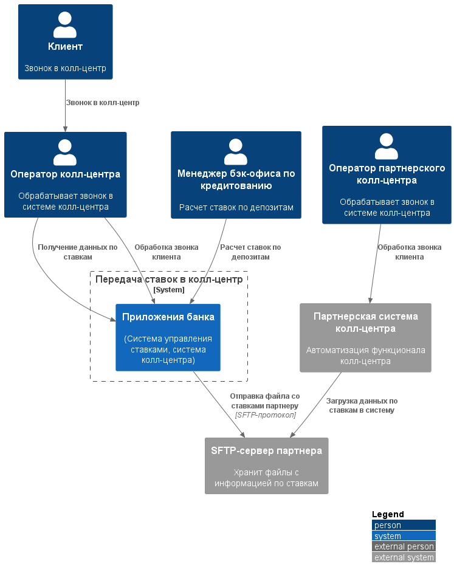
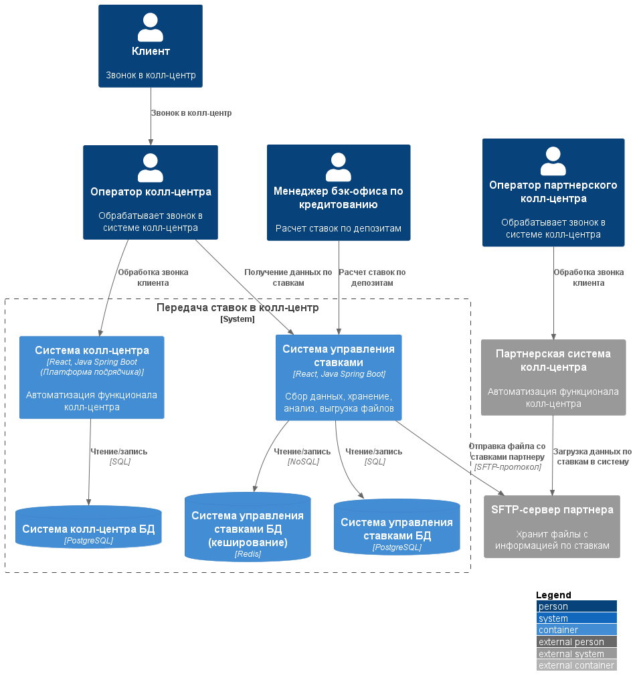

### **Название задачи:**  Передача ставок в кол-центр
### **Автор:** -
### **Дата:** 30.09.2026
### **Функциональные требования**

|**№**|**Действующие лица или системы**|**Use Case**|**Описание**|
| :-: | :- | :- | :- |
| UC1 | Оператор колл-центра, система           | Обработка входящего звонка   | 1. Оператор обрабатывает звонок в системе колл-центра                                             |
|     | колл-центра, система управления ставками| от клиента                   | 2. При запресе информации по актаульным ставкам оператор обращается к данным системы по           |
|     |                                         |                              | управлению ставками                                                                               |
|     |                                         |                              | 3. Оператор консультирует клиента                                                                 |
| UC2 | Специалист отдела кредитования,         | Управление ставками по       | 1. Специалист отдела кредитования рассчитывает ставки в системе по управлению ставками            |
|     | система управления ставками             | депозитам                    | на основе ставки ЦБ и данных портфеля клиентов                                                    |
|     |                                         |                              | 2. Специалист отдела кредитования обновляет информацию по ставкам в системе по управлению ставками|
|     |                                         |                              | 3. Обновленные данные кэшируются                                                                  |
|     |                                         |                              | 4. Обновленные данные отправляются на SFTP-сервер партнера                                        |
| UC3 | Оператор партнерского колл-центра,      | Обработка входящего звонка   | 1. Оператор партнерского колл-центра просматривает данные по ставкам в системе колл-центра, либо  |
|     | система партнерского колл-центра/файл   | от клиента                   | открывает полученный файл                                                                         |
|     |                                         |                              | 2. Оператор консультирует клиента                                                                 |
| UC4 | Система управления ставками,            | Автоматическая отправка файла| 1. Система управления ставками генерирует файл CSV/JSON/XLS (при обновлении или по ручному запуску)|                
|     | система партнерского колл-центра,       | ставок партнёру              | 2. Система управления ставками передает файл по SFTP-протоколу на сервер партнера                 |
|     |                                         |                              | 3. Cистема партнерского колл-центра обрабатывает полученный файл                                  |

### **Нефункциональные требования**
Опишите здесь нефункциональные требования и архитектурно значимые требования.

|**№**|**Требование**|
| :-: | :- |
| U1  | Интерфейс должен соответствовать интерфейсам интернет-банка и сайта, состоять из привычных     |
|     | цветов и брендированных элементов, быть максимально удобным, следовать дизайн-системе          |
| R1  | Все сервисы должны работать 24/7                                                               |
| R2  | При сбое ЦОД сервисы интернет-банка должны быть доступны, переключаться на резервный ЦОД и     |
|     | выдерживать целевую нагрузку                                                                   |
| P1  | Предусмотреть равномерное горизонтальное масштабирование и распределение запросов между        |
|     | серверами, приложениями и ЦОД                                                                  |
| S1  | Максимально использовать существующие технологии и экспертизу банка                            |
| S2  | Подготовить документацию для дальнейшего расширения системы                                    |
| S3  | Подготовить соглашение с партнером о формате передаваемого файла                               |
| S4  | Новые технологии должны быть совместимы с существующими платформами разработки                 |
| +R1 | Система управления ставками должна поддерживать ролевую модель доступа                         |
| +R2 | Данные, передаваемые партнеру должны быть защищены                                             |
| +R3 | Формирование и отправка файла со ставками не должна влиять на производительность REST API      |
| +R4 | Мониторинг выгрузок файлов для партнера и кэша                                                 |
| +R5 | Система по управлению ставками должна масштабироваться горизонтально                           |
| +R6 | Формат файла для партнера версионируется                                                       |
| +R7 | Система по управлению ставками должна выдерживать рост числа читателей                         |
| +R8 | Реализация силами команды банка, с минимальным привлеченим партнеров                           |
| +R9 | При недоступности Redis, переключение на PostgreSQL                                            |

### **Решение**
#### Диаграмма контекста

#### Диаграмма контейнеров

#### Описание принятия решения
Предлагается добавить функционал в новый микросервис "Система управления ставками", основываясь на:
1. Отсутствие доработки системы подрядчика и его привлечения к работам. Операторы колл-центра получают доступ в UI сервиса ставок с ролью «только чтение»;
2. Партнёрский кол-центр — получает ставки файлами через SFTP-протокол. Добавлем модуль экспорта в сервисе ставок;
3. Так как нагрузка на сервис ставок кратно увеличивается, то добавлем Redis для кэширования актуальных ставок. Кэширование допустимо так как ставки пересчитываются один раз в день, на основании ставки центробанка. Если Redis будет недоступен, то API читает из PostgreSQL. Отклик будет медленнее, но сервис продолжит работу.

### **Альтернативы**
|**Альтернатива**|**Причина отказа**|
| :-: | :- |
| REST-интеграция с системой кол-центра банка  | Требует подрядчика. Противоречит требованию                                            |
| API для партнёрского кол-центра              | Партнёр не может делать API-вызовы                                                     |
| Email с файлом                               | Небезопасно, нет гарантий, нет аудита                                                  |
| Без использования системы кэширования        | Сильно большая нагрузка на базу данных системы по управлению ставками. Долгий отклик   |
| Продолжить вести ставки в xls формате        | Увеличивается нагрузка на сотрудников бэкенд-офиса кредитования: нужно следить за тем, |
|                                              | что данные загружены и на сайт, и в интернет-банк и переданы партнеру                  |

**Недостатки, ограничения, риски**

#### Недостатки:
1. Операторы колл-центра работают в двух системах — своя  + сервис ставок;
2. Возможна задержка обновления данных у партнёра (партнер будет консультитровать по неактуальным данным);
3. Redis — новая технология в банке;
4. Зависимость от SFTP-сервера партнёра;
5. Ручное согласование формата с партнёром.

#### Ограничения:
1. Подрядчика желательно не привлекать для доработки система колл-центра;
2. Партнёр не может использовать API — только файлы;
3. SFTP — не очередь — нет гарантий доставки;
4. Необходимо следитть за безопасностью SFTP;
5. Нужно реализовать ролевую модель для доступа к ставкам;
6. Нагрузка на сервис ставок — генерация файла не должна блокировать API.

#### Риски:
1. Операторы колл-центра путаются в двух системах;
2. Утечка данных;
3. Рассинхронизация кэша и БД;
4. Файл потерян или повреждён;
5. Рассинхронизация ставок у партнёра или партнёр не загрузил файл;
6. Обеспечение безопасности при передачи данных между системами.
