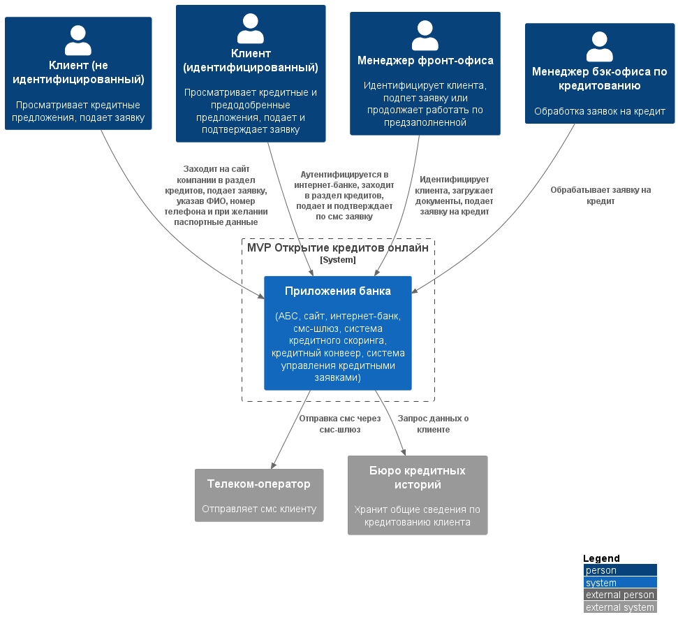
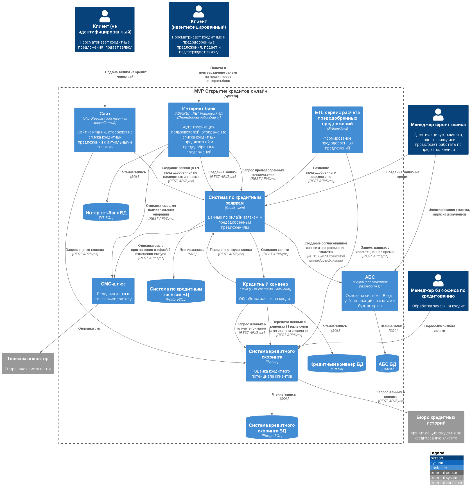

### **Название задачи:**  MVP открытия кредитов онлайн
### **Автор:** -
### **Дата:** 01.10.2026
### **Функциональные требования**

|**№**|**Действующие лица или системы**|**Use Case**|**Описание**|
| :-: | :- | :- | :- |
| UC1 | Клиент (без идентификации), сайт        | Просмотр списка кредитных    | 1. Клиент заходит на сайт компании, без авторизации                                           |
|     |                                         | предложений на сайте компании| 2. Клиент заходит в раздел по кредитным предложениям и видит список доступных                 |
| UC2 | Клиент (без идентификации), сайт        | Подача заявки на кредит      | 1. Клиент выбирает кредитное предложение из списка                                            |
|     |                                         | без паспортных данных        | 2. Клиент заполняет данные: номер телефона, ФИО                                               |
|     |                                         |                              | 3. Сайт передает чувствительные данные, используя шифрование, в АБС/новый микросервис         |
|     |                                         |                              | для обработки                                                                                 |
|     |                                         |                              | 4. Клиент ожидает СМС о решении                                                               |
| UC3 | Клиент (без идентификации), сайт        | Подача заявки на кредит      | 1. Клиент выбирает кредитное предложение из списка                                            |
|     |                                         | с паспортными данными        | 2. Клиент заполняет данные: номер телефона, ФИО, паспортные данные                            |
|     |                                         |                              | 3. Сайт передает чувствительные данные, используя шифрование, в систему скоринга для расчета  |
|     |                                         |                              | оценки клиента (если клиент новый, то только по данным бюро)                                  |
|     |                                         |                              | 4. Клиент сразу видит предварительное решение и может создать заявку                          |
|     |                                         |                              | 5. Клиент создает заявку на кредит                                                            |
|     |                                         |                              | 6. Сайт передает чувствительные данные, используя шифрование, в систему заявок                |
|     |                                         |                              | 7. Клиент ожидает СМС с приглашением в отделение для идентификации                            |
| UC4 | Клиент (без идентификации),             | Идентификация нового клиента | 1. Клиент пришел в офис с документами                                                         |
|     | менеджер фронт-офиса, АБС               | и подача заявки в отделении  | 2. Менеджер фронт-офиса сканирует документы, загружает в АБС                                  |
|     |                                         |                              | 3. Менеджер фронт-офиса может создать сразу новую заявку на кредит или продолжить работу по   |
|     |                                         |                              | предзаполненной заявке в АБС/новом микросервисе                                               |
| UC5 | Клиент (идентифицированный),            | Просмотр кредитных общих     | 1. Клиент аутентифицируется в интернет-банке                                                  |
|     | интернет-банк                           | и персональных предложений   | 2. Клиент заходит в раздел по кредитным предложениям и видит список доступных общих и         |
|     |                                         | интернет-банке               | персональных предложений                                                                      |
| UC6 | Клиент (идентифицированный),            | Подача заявки на кредит      | 1. Клиент выбирает предложение из списка                                                      |
|     | интернет-банк, смс-шлюз,                |                              | 2. Клиент указывает счет и сумму кредита                                                      |
|     | АБС/новый микросервис                   |                              | 3. Интернет-банк через смс-шлюз отправляет смс для подтверждения подачи заявки                |
|     |                                         |                              | 4. Клиент подтверждает операцию                                                               |
|     |                                         |                              | 5. Интернет-банк передает заявку в АБС/новый микросервис для обработки                        |
|     |                                         |                              | 6. Клиент ожидает СМС о статусе заявки                                                        |
| UC7 | Специалист отдела кредитования,         | Обработка заявки на кредит   | 1. Специалист отдела кредитования обрабатывает заявки в кредитном конвеере                    |
|     | кредитный конвеер, система скоринга,    |                              | 2. В результате согласования заявки клиент получает смс и ждет зачисления денег на счет       |
|     | бюро кредитных историй                  |                              |                                                                                               |
| UC8 | Система скоринга, новый микросервис     | Расчет преодобренных         | 1. Необходимо осуществлять расчет предодобренных предложений для отображения в интернет-банке |
|     |                                         | предложений для клиентов     |                                                                                               |
|     |                                         |                              |                                                                                               |

### **Нефункциональные требования**
Опишите здесь нефункциональные требования и архитектурно значимые требования.

|**№**|**Требование**|
| :-: | :- |
| U1  | Интерфейс должен соответствовать интерфейсам интернет-банка и сайта, состоять из привычных     |
|     | цветов и брендированных элементов, быть максимально удобным, следовать дизайн-системе          |
| R1  | Все сервисы должны работать 24/7                                                               |
| R2  | При сбое ЦОД сервисы интернет-банка должны быть доступны, переключаться на резервный ЦОД и     |
|     | выдерживать целевую нагрузку                                                                   |
| P1  | Отклик по всем операциям должен быть максимально быстрым и занимать миллисекунды               |
| P2  | Предусмотреть равномерное горизонтальное масштабирование и распределение запросов между        |
|     | серверами, приложениями и ЦОД                                                                  |
| S1  | Максимально использовать существующие технологии и экспертизу банка                            |
| S2  | Подготовить документацию для дальнейшего расширения системы                                    |
| S3  | Новые технологии должны быть совместимы с существующими платформами разработки                 |
| +R1 | Данные, получаемые с сайта компании, необходимо защищать с помощью механизма шифрования трафика|
| +R2 | Данные, получаемые с интернет-банка, необходимо защищать с помощью механизма шифрования        |
| +R3 | Фронтенд - React.js / ASP.NET MVC 4.5. Бэкенд - php / .NET Framework 4.5 / python / java       |
| +R4 | Базы данных - MS SQL / Oracle / Postgresql                                                     |
| +R5 | Очередь сообщений - в приоритете kafka. Несовместима с текущей версией платформы интернет-банка|
| +R6 | База данных системы АБС уже перегружена                                                        |
| +R9 | АБС может масштабироваться только вертикально из-за своей БД                                   |
| +R10| Новых клиентов нельзя принимать без личной проверки документов в отделении                     |
| +R11| Функционал СМС реализован в ядре интернет-банка, но доработка подрядчика нежелательна, нужно   |
|     | реализовать силами команды банка                                                               |
| +R12| Интернет-банк сейчас работает в одном ЦОД на одной группе серверов. Есть резервный ЦОД         |
| +R13| Горизонтальное масштабирование новых сервисов                                                  |
| +R14| Система скоринга испытавает повышенную нагрузку в рабочие часы. Не нагружать дополнительно     |
|     | процессами по предрасчету скоринга                                                             |
| +R15| Обмен данными между АБС и кредитным конвеером осуществляется 1 раз в сутки.                    |
|     | Проводить чаще нельзя                                                                          |
|     |                                                                                                |

### **Решение**
#### Диаграмма контекста

#### Диаграмма контейнеров

#### Описание принятия решения
Предлагается добавить два новых микросервиса "Система управления кредитными заявками" и "ETL-сервис расчета предодобренных предложений", основываясь на:
1. Разделение доменов. АБС — это основная система, где производится учёт операций по счетам и бухгалтерия. Заявки — не её работа. Выносим в отдельный сервис, чтобы разгрузить перегруженную БД АБС. Система управления заявками единая точка входа информации по заявкам.
2. Минимум изменений в функционирующих системах.
3. Использование существующих технологий. Java Spring Boot (есть в кол-центре и у команды АБС), PostgreSQL, REST, JDBC, React.js
4. Возможность горизонтального масштабирования. Новые сервисы масштабируются горизонтально, АБС же может масштабироваться только вертикально из-за своей БД
5. Без избыточной инфраструктуры. Kafka несовместима с интернет-банком, Oracle AQ грузит ту же БД. Для MVP решения синхронные вызовы, в перспективе возможно внедрить брокер сообщений.
6. ETL-процесс расчета предодобренных предложений вынесен отдельно, не нагружая систему заявок. Процесс можно запускать в ночное время не нагружая систему скоринга в рабочие часы, либо горизонтально масштабировать систему скоринга, новый экземпляр которой будет работать только с ETL-сервисом.

### **Альтернативы**
|**Альтернатива**|**Причина отказа**|
| :- | :- |
| Управление онлайн заявками в АБС             | Усугубляет перегрузку, нет горизонтального масштабирования при увеличении нагрузки     |
| Использовать обмен АБС и кредитного конвейера| Решение не даст возможность обработать заявку в тот же день                            |
| Один микросервис вместо двух                 | Разные домены, разная нагрузка, разный жизненный цикл                                  |
| Использование брокера сообщений Kafka        | Новая технология, избыточно для MVP. Нужен адаптер для интернет-банка                  |
| Oracle AQ                                    | Очередная нагрузка на БД АБС                                                           |
| Прямая запись в БД АБС                       | Антипаттерн, обход бизнес-логики PL/SQL                                                |
| Python для сервисов                          | Меньше экспертизы, хуже JDBC+Oracle                                                    |
| Пакетная обработка предодобренных предложений| Сильно нагружает сервис                                                                |
| в сервисе заявок                             |                                                                                        |
|                                              |                                                                                        |

Батч в сервисе заявок	Нагружает онлайн-сервис 24/7.
**Недостатки, ограничения, риски**

#### Недостатки:
1. Два новых сервиса — нужно разрабатывать и поддерживать;
2. Синхронные вызовы блокируют операции, есть вероятность потери данных.
3. Данные по заявке должны быть синхронизированны в трех системах: АБС(проводка платежа), кредитный конвеер (рассмотрение и согласование), ссистема по заявкам (хранение, работа с жизненным циклом заявки)

#### Ограничения:
1. БД АБС уже перегружена;
2. АБС масштабируется только вертикально;
3. Ограничения при доработках систем подрядчиков;
4. У АБС нет API — только PL/SQL;
5. Обмен АБС и кредитного конвеера только один раз в сутки;
6. Систему скоринга нельзя дополнительно нагружать в рабочие часы;

#### Риски:
1. Недоступность сервисов при интеграции данных;
2. Дубли данных при повторных вызовах;
3. Перегрузка БД АБС;
4. Рост нагрузки на сервис ставок и онлайн-заявок;
5. Интеграция через JDBC;
6. Обеспечение безопасности при передачи данных между системами;
7. Рассинхронизация данных по заявкам;
8. Утечка чувствительных данных;
9. Ночное окно ETL ограничено — может не хватить при большом числе клиентов.
